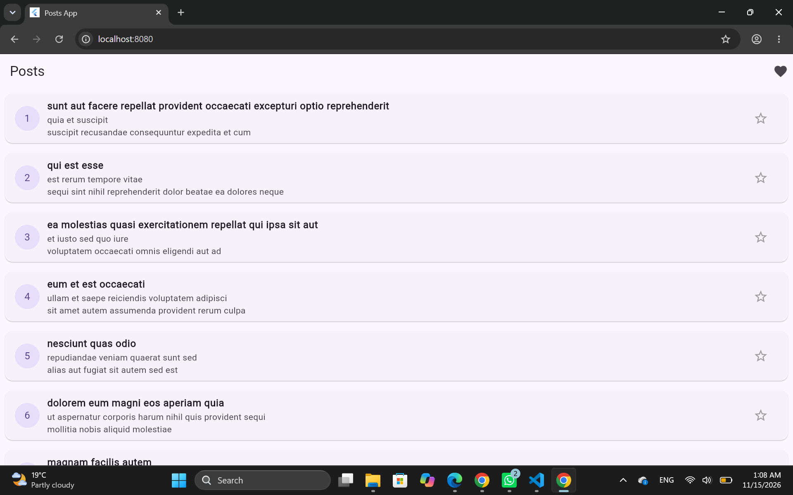
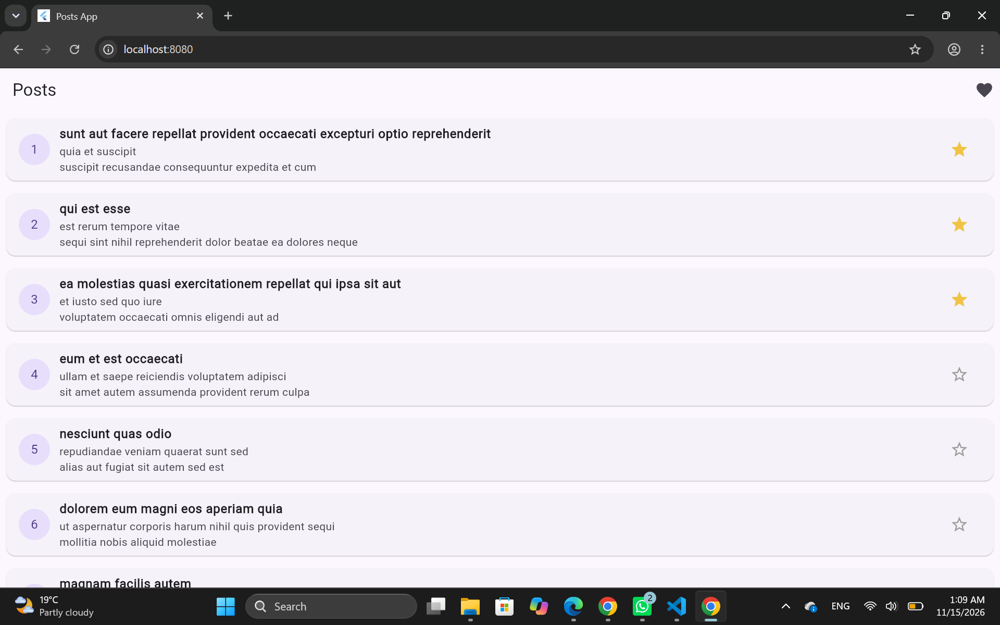
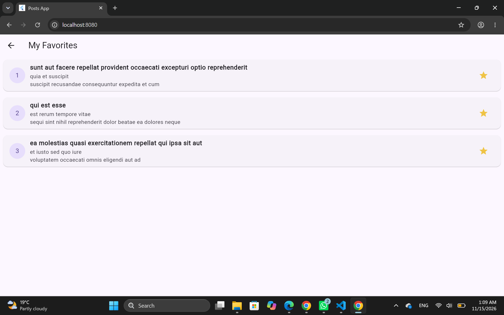
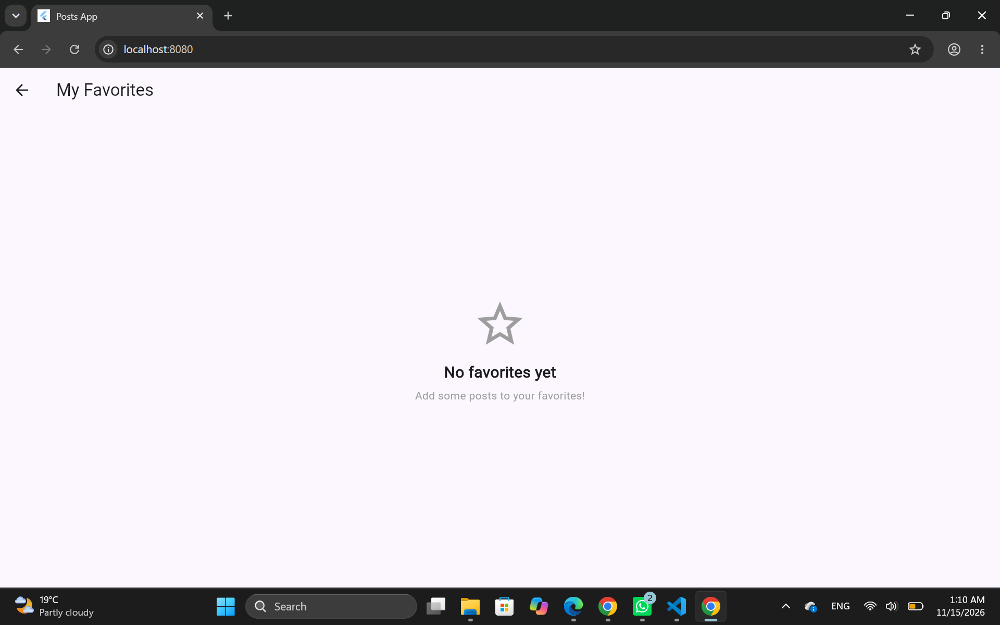
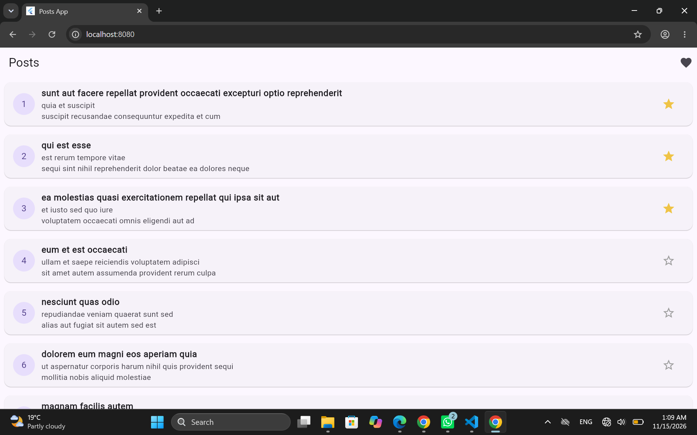

# Hive Posts & Favorites App

## 1. About the Project

This project is a Flutter application developed for the Mobile Computing course.

The app displays posts from an online API and uses Hive to save them locally. Users can add posts to their favorites, remove them, and access saved posts even without an internet connection.

## 2. Application Screenshots

### Posts Screen
Displays the available posts. Users can select posts by tapping the star icon.



### Favorites Selection
Shows posts selected as favorites.



### Favorites Screen
Displays all posts added to favorites.



### Empty Favorites Screen
Displayed when the user has not added any favorite posts.



### Offline Mode
Shows that previously saved posts are still available without an internet connection.



## 3. Technologies Used

- Flutter
- Dart
- Hive Local Database
- JSONPlaceholder API

## 4. How to Run the Project

### Requirements
- Flutter SDK
- Visual Studio Code
- Internet connection for the initial loading of posts

### Steps

1. Clone the repository:

```bash
git clone https://github.com/YOUR_USERNAME/posts-favorites-app.git
```

2. Open the project folder:

```bash
cd posts-favorites-app
```

3. Install the dependencies:

```bash
flutter pub get
```

4. Run the application:

```bash
flutter run -d chrome --web-port=8080 --no-web-resources-cdn
```

## 5. Assignment Information

- **Course:** Mobile Computing
- **Assignment:** Hive – Local NoSQL Storage
- **Project:** Posts & Favorites App


